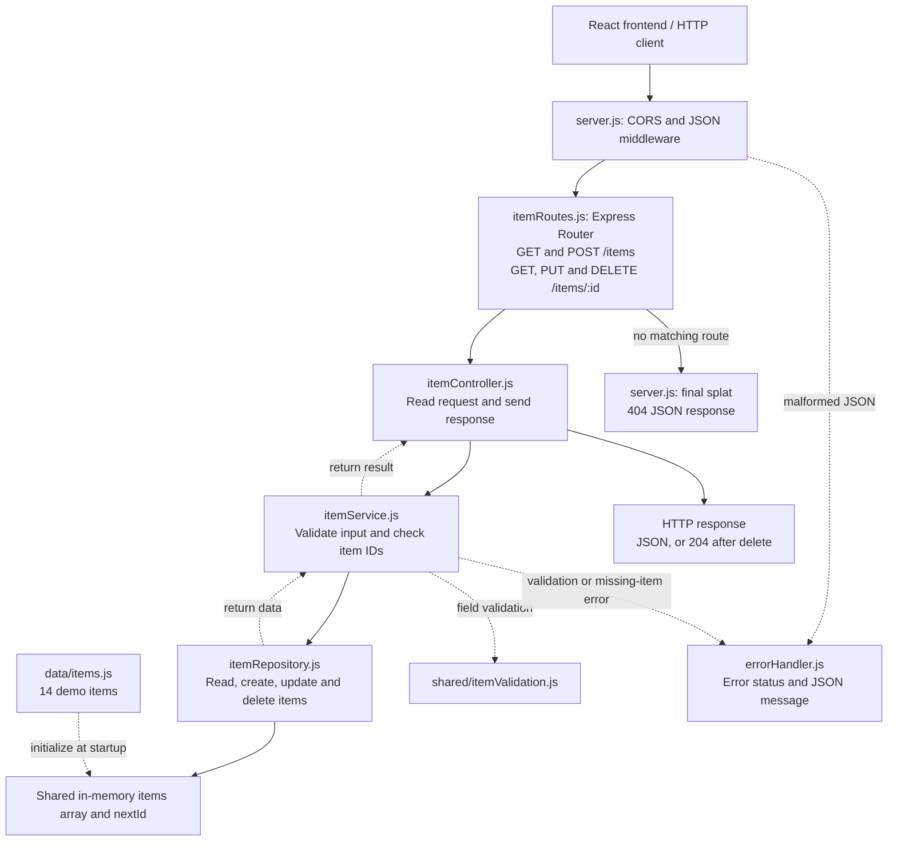

# FindIt USEK

**Lost on campus. Found together.** A responsive campus lost-and-found platform for CSC457 Project 1: React + React Router + Redux Toolkit, connected through HTTP to a Node.js/Express in-memory CRUD API.

This is an independent educational prototype, inspired by the supplied MyUSEK reference. It is not an official USEK service.

## Run locally

Prerequisites: **Node.js 24 LTS** and npm 11. Create `backend/.env` containing only `PORT=3001` if it is missing; this local file is ignored by Git. From `C:\CS\React`:

```powershell
npm ci
npm run dev
```

- Frontend: http://127.0.0.1:5173
- API: http://localhost:3001/items
- Press Ctrl+C to stop both applications.

The backend loads `PORT` from `backend/.env` in `server.js` using the built-in Node `loadEnvFile()` function. The frontend works without an environment file; optionally copy `frontend/.env.example` to `frontend/.env` to change `VITE_API_BASE_URL` (defaults to `/api`, proxied to the local API). Restart the backend manually after code or configuration changes. The API allows requests from all origins through `cors()`.

Use `npm run dev:frontend` and `npm run dev:backend` for separate terminals. `npm run build` writes the production SPA into `frontend/dist`. To inspect that build locally, run `npm run start -w backend` in one terminal and `npm run preview -w frontend` in another. Vite serves direct SPA URLs in development and preview; any future static host must rewrite application routes to `index.html`.

## Vercel deployment branch

`main` contains the local Express app. Deploy `vercel-deployment` on Vercel.
Set **Root Directory** to the repository root (`.`), use the **Other** framework
preset, and select `vercel-deployment` under **Settings > Environments >
Production > Branch Tracking**. Keep `VITE_API_BASE_URL` unset (defaults to `/api`).

The root `vercel.json` builds the UI into `frontend/dist` and configures the
Node function at `api/index.js`, including backend and shared source files.
The function reuses the existing item Router and error handler. It does not
start the local server or load the local `backend/.env` file.

API requests retain their original URL and query string. `/api/items` returns
the fourteen seeded items, `/api/items/1` returns the first item, and unknown
API endpoints return JSON 404 errors. The SPA fallback excludes `/api`.
Refreshing a client route such as `/items/1` continues to serve the UI.

Storage remains in memory: warm requests to one instance can share changes,
while cold starts and separate function instances get fresh seed data.
After deployment, verify JSON responses from `/api/items` and `/api/items/1`
and refresh `/items/1` to check the UI.

## Open on your phone

Run `npm run dev`, connect your phone and computer to the same Wi-Fi, and open the Network URL printed by Vite. The frontend listens on the local network and sends `/api` requests through Vite to the backend on port 3001. Keep both processes running. If port 5173 is already occupied, run `npm run dev -w frontend -- --port 5174` with the backend running. If Windows asks, allow Node.js on private networks.

## What is included

- Fourteen fictional lost/found items, including two returned items.
- Home with live counters and recent items; Explore with text search, combined filters, URL state, and date sorting.
- Item details; shared validated Create/Edit form; dedicated Delete confirmation.
- Optional public email; item and location photo URLs with previews and safe fallbacks.
- About and a validated **local demonstration** Contact form.
- Poppins fonts bundled locally, user-supplied USEK photos and logo, real stock item and location photography, responsive navy/blue styling, semantic controls and keyboard focus handling.
- Loading, empty, no-results, error, retry, missing-item and unknown-route states.

## Routes and academic checklist

| Required view | Route | Operation |
|---|---|---|
| Home | `/` | Collection GET for live counts/recent items |
| About Us | `/about` | Purpose and prototype limitations |
| Contact Us | `/contact` | Event handling, local validation and honest demo confirmation |
| Display all | `/items` | `GET /items` |
| Display single | `/items/:id` | `GET /items/:id` |
| Submit new | `/items/new` | `POST /items` |
| Update existing | `/items/:id/edit` | GET + `PUT /items/:id` |
| Delete existing | `/items/:id/delete` | GET + deliberate `DELETE /items/:id` |

### Assignment requirements

Checked against both pages of the CSC457 Project 1 assignment before removing the unused source documents. Backend is worth 20 points; frontend is worth 80 points.

| PDF requirement | Implementation |
|---|---|
| Node.js/Express Web API | `backend/src/server.js` |
| One entity type with an in-memory dataset | Items in `backend/src/db/itemRepository.js`; 14 demo items reset on restart |
| Read all, read one, create, update and delete through HTTP | GET `/items`, GET `/items/:id`, POST `/items`, PUT `/items/:id`, DELETE `/items/:id` |
| At least five properties with different data types | 11 properties, including numeric `id`, string fields and boolean `returned` |
| Bare-bones CRUD without database, authentication, authorization or business workflows | In-memory array, CRUD handlers and input validation only |
| React SPA connected to the backend | React pages call the API through `itemsApi.js` and Redux async actions |
| All eight required views | Home, About, Contact, list, details, create, edit and delete; routes listed above |
| Effective use of components, props and state | Shared `ItemCard`, `ItemForm` and UI components; props and local React state |
| UI/UX emphasis | Responsive layouts, images, keyboard navigation, loading/error feedback and form validation |
| Contact form with event handling and input validation | Controlled fields, `onSubmit`, `validateContact()` and local confirmation |
| Entity views send HTTP requests for CRUD | All five operations use the Express API; the frontend updates Redux from responses |
| React Router for client-side navigation | `BrowserRouter`, `Routes`, `Route`, `Link` and `NavLink` |
| Redux for centralized application state | Redux Toolkit store and item slice, connected with React-Redux |

The PDF lists learning outcomes 1, 4 and 5 without defining them. The original assignment remains available in Git history.

## Architecture

The visual refinement uses the supplied campus panorama for the homepage hero and the courtyard photograph for the community story, About, and Contact. The header/footer use the provided USEK logo alongside the service name; there is no custom application icon. Homepage search opens the existing Explore view with its query in the URL. The Explore card/filter layout and item breadcrumbs retain their established behavior. See `ASSET_CREDITS.md` for the supplied file mapping.

```text
frontend/src/
  app/              Store and route definitions
  features/items/   API requests, Redux item state, selectors, and fetching hooks
  components/       Shared UI, layout, item cards/photos/filters/form
  pages/            Eight required views plus 404
  styles/           Global design tokens and base styles
backend/src/
  server.js         Sets up Express middleware/routes and starts the HTTP server
  data/             Fictional seed items
  routes/           Five item REST endpoints
  controllers/      HTTP requests, responses and status codes
  services/         Item validation, ID checks and not-found handling
  db/               In-memory repository, CRUD storage and ID generation
  middleware/       Centralized API error responses
  errors/           Structured service errors
shared/             Pure model constants and validation
```

### State and data flow

1. A route page dispatches a Redux Toolkit async thunk.
2. The central fetch service sends an HTTP request to Express.
3. Express validates and reads/changes its array, returning JSON.
4. Redux reducers update the item array and selected item from the API response.
5. Selectors derive counts, recent items and filtered lists. Components receive items through props.

Form values, errors, previews, menu state and Contact feedback belong in local React state. Explore filters belong in URL search parameters. Redux keeps a plain item array, one selected item, and loading/error states for fetching and saving. Collection pages fetch the full list; detail pages fetch one item by ID. No localStorage is used.

Backend flow: `routes -> controllers -> services -> repository`. The service validates item input and resolves missing/invalid IDs; the controller only translates HTTP requests and responses. The repository owns one shared in-memory array and monotonic ID counter per server process, and returns copies. Seed fixtures stay in `data/`. Express error middleware preserves structured validation errors and handles malformed JSON. Storage remains in memory as required by the assignment; this is not a persistent database.

### Backend request flow



The Router selects a controller. The controller calls the service, and the service uses the repository to access the shared array. The final splat handles unmatched URLs; error middleware handles thrown errors. Restarting the backend restores the demo items.

## Item and API

An Item has **11 properties**: numeric immutable `id`; strings `title`, `description`, `category`, `type`, `location`, `date`, `contactEmail`, `imageUrl`, `locationImageUrl`; and boolean `returned`. Open/Returned is derived from that one boolean.

Title: 3–100 characters; description: 10–2000; location: 2–120; category/type: allowed enums; date: real `YYYY-MM-DD` calendar date. Email and both photos are optional strings. Email is syntax-validated, not ownership-verified. Image values allow absolute HTTP(S) URLs or project-local `/images/…` paths. These fields reference images and never upload files. Dates are displayed as calendar dates without timezone shifting.

| Endpoint | Success | Other responses |
|---|---|---|
| `GET /items` | 200 array | 500 |
| `GET /items/:id` | 200 object | 400 malformed ID, 404 absent |
| `POST /items` | 201 created object | 400 invalid body |
| `PUT /items/:id` | 200 updated object | 400 invalid ID/body, 404 absent |
| `DELETE /items/:id` | 204 no body | 400 invalid ID, 404 absent |

POST defaults omitted optional strings to `""` and omitted `returned` to `false`. PUT requires every required editable field including the boolean; it is a full update rather than a partial patch. Body IDs and unknown properties are ignored. IDs increment independently of array length and are not reused within a server session. JSON bodies are capped at 32 KB (413 when exceeded). Errors use `{ "message": "…", "errors": { "field": "…" } }`, with field errors only for validation.

Example request, usable in PowerShell:

```powershell
$item = @{
  title = 'Blue lecture notebook'
  description = 'A blue notebook with a silver sticker on the front cover.'
  category = 'Books'
  type = 'Lost'
  location = 'Library'
  date = '2026-10-15'
  returned = $false
  contactEmail = ''
  imageUrl = 'https://images.pexels.com/photos/5905437/pexels-photo-5905437.jpeg'
  locationImageUrl = ''
} | ConvertTo-Json

$created = Invoke-RestMethod http://localhost:3001/items -Method Post -ContentType 'application/json' -Body $item
Invoke-RestMethod "http://localhost:3001/items/$($created.id)"
```

## Build and lint

```powershell
npm run lint
npm run build
```

Automated test suites and their dependencies have been removed from this project.

## Demonstration and course defense

1. Open Home and explain that counts derive from fetched items, not hardcoded numbers.
2. Explore, search for earbuds, apply filters, and open an item. Show the HTTP GET in browser developer tools.
3. Create an item with optional photos/email, edit it, and mark it returned. Show POST/PUT and Redux state changes.
4. Open the dedicated delete page, cancel once, then confirm deletion. Show DELETE and the updated list.
5. Submit Contact with empty fields, then valid values. Explain that validation is local and **no email is sent**.
6. Explain component props (`ItemCard`), local state (`ItemForm`), centralized state (items slice), routing, and shared pure validation.
7. Restart the API and show the original fourteen records. Explain the deliberate assignment constraint: memory only.

## Honest prototype limitations

- Items reset on backend restart. There is no database or persistence.
- There are no accounts or authorization; anyone with access can edit/delete items.
- Contact validates locally and sends/stores nothing. Optional public item email is the only contact method.
- Items, photos and ownership claims are unverified. Never publish personal ID photos or sensitive identifiers.
- Seed items use real Pexels stock photos, including location reference photos; they do not depict verified USEK items or finding locations. See `ASSET_CREDITS.md`. External photo URLs work but may expire, fail or cause requests to third-party hosts.
- Seed emails use reserved `example.com` addresses and do not represent real students.
- Styling is MyUSEK-inspired, not an official brand specification or endorsement.
- No deployment, messaging, uploads, claims verification, maps, or matching service is included.

Research sources: [React Router](https://reactrouter.com/start/declarative/installation), [Redux Toolkit/React-Redux](https://redux.js.org/tutorials/quick-start), [Vite](https://vite.dev/guide/), [Express](https://expressjs.com/en/5x/api/).
